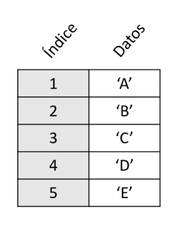
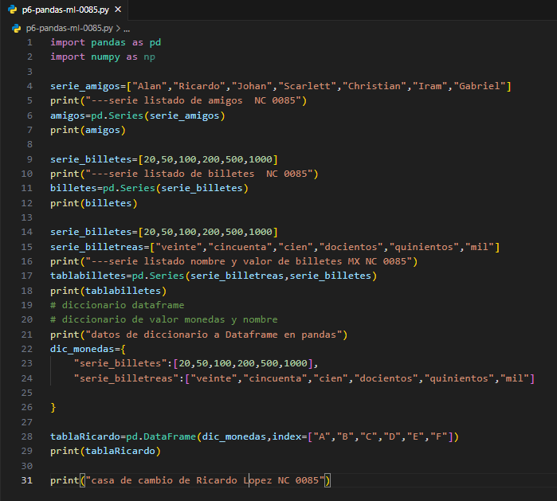
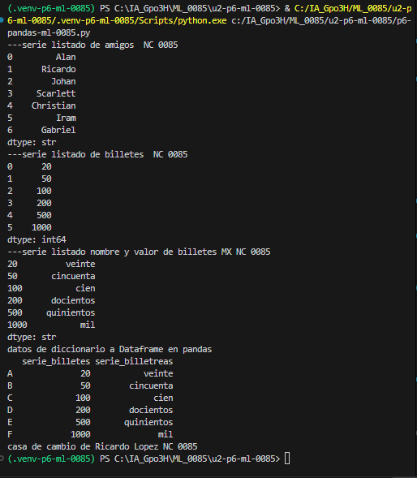

## serie

- En programación, una serie es una secuencia ordenada de valores (generalmente números) que siguen una regla, patrón o lógica matemática específica, 
 o bien la suma acumulada de los elementos de una sucesión
- Cómo se programan: Se implementan utilizando estructuras de control repetitivas (bucles como for o while) acompañadas de variables acumuladoras o auxiliares que van calculando el siguiente término.

## el codigo 

## el resaultado
